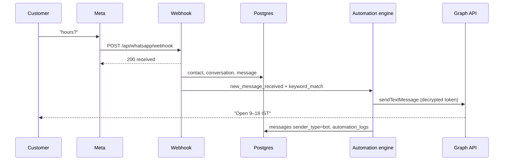

# Architecture

Technical description of how wacrm is put together. For runbooks and env vars see [Engineering](./engineering.md). WhatsApp Cloud API: [WhatsApp Meta integration](./whatsapp-meta.md). For HTTP contracts see [Public API](./public-api.md).

## Stack

| Layer | Choice |
| --- | --- |
| App | Next.js App Router (see `package.json` for the pinned version), React, TypeScript, Tailwind |
| Auth + DB + realtime + storage | Supabase (Postgres, GoTrue, RLS, Storage) |
| WhatsApp | Meta Cloud API (`graph.facebook.com`, currently v21.0 in `src/lib/whatsapp/meta-api.ts`) |
| i18n | `next-intl` — `messages/en.json`, `messages/ko.json` |

This repo is a **template**: one deploy, one Supabase project, one (or a few) WhatsApp numbers stored per **account** in `whatsapp_config`.

## Tenancy

After migration `017_account_sharing.sql`:

- Every operational row carries `account_id`.
- Users join via `account_members` with role `owner | admin | agent | viewer`.
- Postgres RLS uses `is_account_member(account_id, min_role)`.
- The browser uses the Supabase **anon** key + user JWT. RLS enforces tenancy.
- Webhooks, automation engine, flow engine, public API key auth, and cron use the **service role** client and **must** filter by `account_id` in application code (RLS is bypassed).

A forged `contact_id` on the automations engine is refused after an ownership check (`runAutomationsForTrigger`).

## High-level request paths

### Browser (dashboard)

```
Browser  →  Next.js RSC / client components
         →  Supabase JS (RLS) for lists, realtime inbox
         →  Next.js Route Handlers under /api/* for privileged writes
                (send, WhatsApp config, automations CRUD, AI, invites, API keys)
```

Session cookies are managed with `@supabase/ssr`. Middleware (`src/middleware.ts`) sends unauthenticated users to `/login` for dashboard paths.

### Meta → wacrm (inbound)

```
Meta  →  POST /api/whatsapp/webhook
      →  HMAC verify (META_APP_SECRET, X-Hub-Signature-256)
      →  200 { status: "received" } immediately
      →  after() processWebhook:
            resolve whatsapp_config by phone_number_id
            decrypt access_token (AES-256-GCM)
            upsert contact (phone normalize + dedupe)
            upsert conversation
            insert message (text/media/interactive/reaction/…)
            optional: download media via Meta
            dispatchInboundToFlows  (awaited; may consume)
            runAutomationsForTrigger (awaited inside after())
            dispatchInboundToAiReply (if text, not consumed, AI enabled)
            dispatchWebhookEvent     (account outbound webhooks)
```

GET `/api/whatsapp/webhook` is Meta’s subscribe challenge (`hub.verify_token` vs stored verify tokens).

### wacrm → Meta (outbound)

Shared send core: `src/lib/whatsapp/send-message.ts`.

Callers:

- `POST /api/whatsapp/send` — inbox / contact detail
- `POST /api/v1/messages` — public API
- `src/lib/automations/meta-send.ts` — automation steps
- `src/lib/flows/meta-send.ts` — flow nodes
- Broadcast worker — templates to many recipients

Flow: load `whatsapp_config` for `account_id` → `decrypt(access_token)` → `phoneVariants()` retry if Meta says recipient not in allowed list → persist `messages` row → pause active flow runs on human send.

Graph errors are formatted in `formatMetaErrorMessage` (HTTP status, code, type, fbtrace_id). Code **190** is an invalid/expired token.

## Data model (core)

| Table | Role |
| --- | --- |
| `profiles` | User display name, avatar, `account_id` |
| `accounts` / `account_members` / `invitations` | Team |
| `whatsapp_config` | One row per account: phone_number_id, waba_id, encrypted tokens, registration timestamps |
| `contacts`, `tags`, `contact_tags`, `custom_fields`, `contact_custom_values`, `contact_notes` | CRM |
| `conversations`, `messages` | Inbox; `sender_type` agent \| contact \| bot |
| `pipelines`, `pipeline_stages`, `deals` | Sales |
| `message_templates` | Synced / submitted Meta templates |
| `broadcasts`, `broadcast_recipients` | Campaigns |
| `automations`, `automation_steps`, `automation_logs`, `automation_pending_executions` | Rules engine |
| `flows`, flow nodes / edges / runs | Bot canvas |
| `api_keys` | Hashed public API keys + scopes |
| `webhook_endpoints` | Outbound HTTPS callbacks |
| AI config / knowledge / usage tables | BYOK assistant |

Schema evolves only via numbered files in `supabase/migrations/` (`001` … current). Apply in order.

## Encryption

`ENCRYPTION_KEY` — 32 bytes hex (64 chars). AES-256-GCM for:

- WhatsApp `access_token` and `verify_token`
- AI provider keys
- Outbound webhook secrets

Format: `iv:ciphertext:authTag` (hex). Legacy CBC (`iv:ciphertext`) is decrypt-only; send paths upgrade to GCM when they see it.

**Rotating `ENCRYPTION_KEY` orphans every ciphertext.** Operators must re-save WhatsApp, AI keys, and webhook secrets.

## Automation engine

`src/lib/automations/engine.ts`

1. Filter `automations` by `account_id`, `trigger_type`, `is_active`.
2. `triggerMatches` (keywords, reply ids, tag id, …).
3. Insert `automation_logs`, walk `automation_steps` by `position`.
4. `condition` recurses into `branch` yes/no children.
5. `wait` inserts `automation_pending_executions`; cron resumes.

Never throws to the webhook caller; failures go to logs + `console.error`.

## Flow engine

`src/lib/flows/engine.ts`

Per-contact **run** with a pointer at the current node. Interactive replies advance by button/list **id**. `dispatchInboundToFlows` returns `{ consumed }`. If `consumed`, webhook skips content-level automations and AI auto-reply.

Node types: start, send_message, send_buttons, send_list, send_media, collect_input, condition, set_tag, handoff, end.

## AI path

- Draft: `POST /api/ai/draft` (agent-initiated).
- Auto-reply: `dispatchInboundToAiReply` after flows, before/alongside outbound webhooks.
- Knowledge: full-text default; optional embeddings.
- Usage logged for the Agents → Usage tab.

## Public API vs dashboard API

| Surface | Auth | Audience |
| --- | --- | --- |
| `/api/v1/*` | `Authorization: Bearer wacrm_live_…` | External systems |
| `/api/whatsapp/*`, `/api/automations/*`, … | Cookie session | Dashboard |
| `/api/whatsapp/webhook` | Meta signature | Meta only |
| `/api/automations/cron`, `/api/flows/cron` | `x-cron-secret` | Scheduler |

API keys: SHA-256 at rest, scopes listed in [public-api.md](./public-api.md). Rate limit **120 req/min/key**, in-memory per process.

## Realtime

Inbox uses Supabase realtime on `messages` / conversations so new inbound rows appear without refresh. Presence (`touch_presence` RPC) is best-effort for “who’s online.”

## Security properties (product)

- RLS on tenant tables.
- Webhook HMAC (`META_APP_SECRET`).
- Outbound webhook SSRF guards (HTTPS, no private IPs).
- CSP / rate limits on sensitive routes.
- Service role never shipped to the browser.

See `.github/SECURITY.md` for reporting.

## Repository map

```
src/app/(auth)            login, signup, password, join invite
src/app/(dashboard)       UI routes
src/app/api               Route Handlers
src/components            inbox, automations, flows, settings, …
src/lib/whatsapp          Meta client, send core, webhook signature
src/lib/automations       engine, validation, templates
src/lib/flows             flow engine
src/lib/ai                BYOK assistant
src/lib/auth              roles, API key context
supabase/migrations       SQL
mcp-server                MCP wrapper over /api/v1
messages                  i18n
docs                      this documentation
```

## Sequence: inbound text that should auto-reply



If Graph returns 401/190, the log step is `failed` and the agent still sees the inbound “hours?” in Inbox.
